# Contribution Galaxy

Your GitHub year, drawn as space. Two animated pictures, redrawn every day from your real contribution calendar.

## The galaxy



Every day of the year sits on one of two spiral arms. A year ago is in the core, today is on the rim, so the galaxy grows outward as you ship. Every day you shipped something is a star: blue for a light day, gold for a big one. The whole disc turns.

## The star chart



The contribution grid as a night sky. A ship flies from star to star in the order you lit them, and each day's count rises off its star as the ship arrives.

## Put it on your own profile

1. Press **Use this template** or fork this repository.
2. Open the **Actions** tab and turn the workflows on.
3. Run **Draw the sky** once by hand. After that it redraws every day.
4. Add one of these lines to the README of your profile repository (the one named after you):

```markdown


```

Nothing to install and no secret to add: the workflow reads your public calendar with the token every run already has, and commits the pictures under your own name.

## Run it on your machine

Python 3.9 or newer, nothing else.

```sh
GITHUB_TOKEN=your_token python3 galaxy.py --user YOUR_NAME --out galaxy.svg
GITHUB_TOKEN=your_token python3 starchart.py --user YOUR_NAME --out starchart.svg
```

The pictures are plain SVG with no script in them, so they play inside a README. People who ask their system for less motion get a still picture.

## License

MIT
